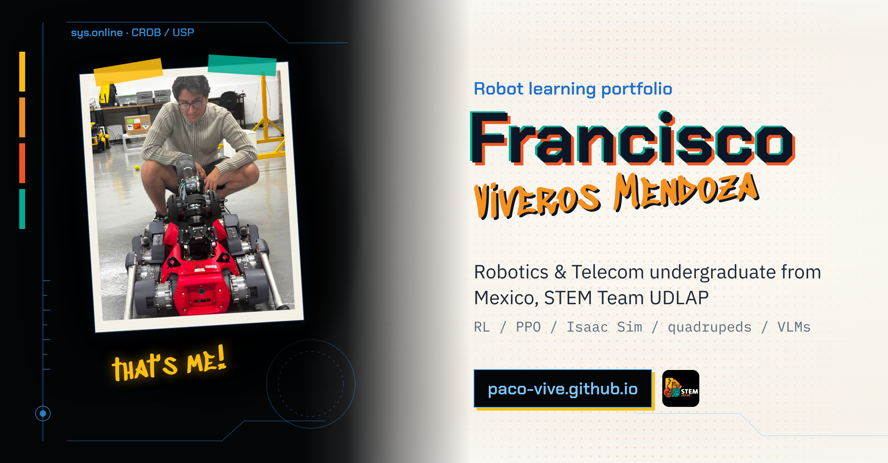
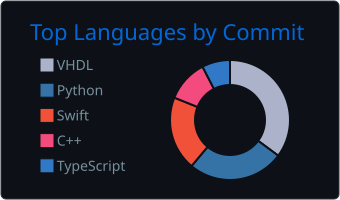
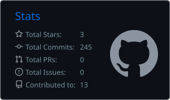

  

  
  
  
  

## Hi, I'm Paco 👋

I'm a **Robotics & Telecommunications Engineering** student at UDLAP (Mexico), part of the **STEM Representative Team**, and a research intern at the **USP Center for Robotics (CROB)** in São Carlos, Brazil.

I train **reinforcement learning** policies for an **ANYmal D** quadruped with a robotic arm in **NVIDIA Isaac Lab**, and I connect **vision-language models** to them so the robot can plan its own tasks. I want to find the math that will let robots work anywhere, for people.

- 🔭 **Now:** sim-to-real transfer of a locomotion policy to the real ANYmal D
- 🧠 **Learning:** the theory behind RL, control and learning with guarantees
- 🏆 **Latest:** International Gold Medal at INFOMATRIX Iberoamérica 2026 · 5th place nationally at the Mexican Robotics Tournament 2026
- 🌎 **Languages:** Spanish (native), English (fluent), German (A2)

## 🦿 Research at CROB

| | Project | What it does |
|:-:|---|---|
|  | [**Ball catching**](https://github.com/paco-vive/anymal-arm-catch-ball) | One PPO policy moves all 19 joints (legs, arm, gripper) to catch a thrown ball. |
|  | [**Locomotion with an arm**](https://github.com/paco-vive/anymal-arm-locomotion) | Velocity-tracking gait for the ANYmal D carrying a DynaArm, 2048 parallel environments. |
|  | [**Cube lifting**](https://github.com/paco-vive/anymal-arm-lift-cube) | The arm learns to grasp and lift while a frozen walking policy keeps the robot standing. |
|  | [**VLM planner**](https://github.com/paco-vive/anymal-claude-vlm-planner) | Claude sees through the robot's camera and chooses skills; reached the table in 12 of 14 runs. |

Code from CROB is confidential; each project page has videos, the MDP and the architecture.

## 🛠️ More projects

| Project | Highlights |
|---|---|
| [**KATA-bot**](https://github.com/paco-vive/KATA-bot-Autonomous-Waste-Collection-Robot) | Autonomous beach-cleaning robot · OpenCV + Raspberry Pi 4 + ESP32 · **5th nationally, TMR 2026** |
| [**UAV PAKAL**](https://github.com/paco-vive/UAV-PAKAL-Secure-Communication) | Anti-jamming drone links · FHSS + AES-256 · GNU Radio, HackRF, BladeRF, wavelets |
| [**Delivery drone**](https://github.com/paco-vive/ROS2-Autonomous-UAV-Landing-Vision-Based-Precision-Control) | ROS 2 + Gazebo · vision-based landing, now adding package pickup |
| [**UrbanOS**](https://github.com/paco-vive/UrbanOS) | Gemini + NASA Earth data for urban planning · **NASA Space Apps Global Nominee** |
| [**IB desk**](https://github.com/paco-vive/CAD_IB_Certification) | Low-cost portable school desk in CAD · my first engineering design |

## 🧰 Toolbox

**Languages**
 

**Robot learning & simulation**
 

**Perception & AI**
 

**Telecom & hardware**
 

**Robots I work with**
 

## 📊 On GitHub

  
  

  

STEM Team UDLAP · Puebla, Mexico · São Carlos, Brazil

